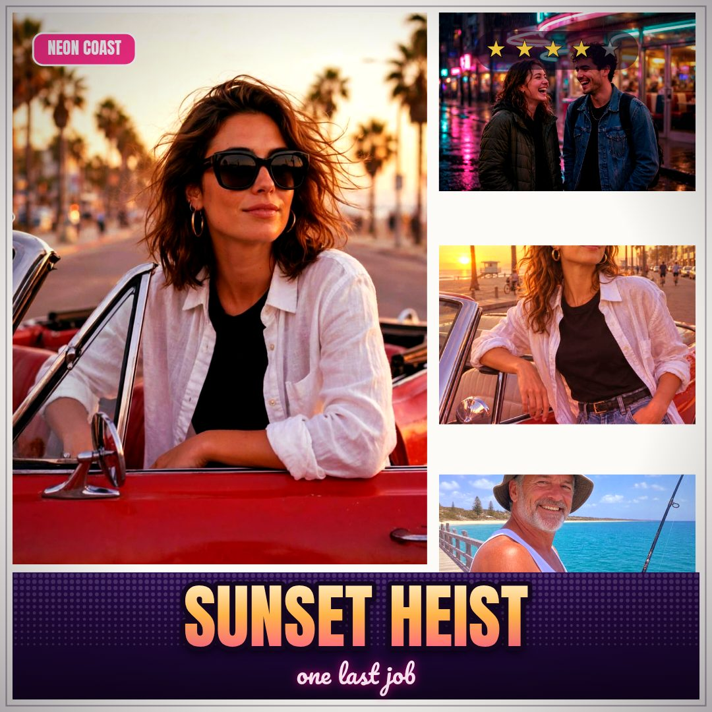

[](https://make.fun/bounty/gta6-cover-art-01)
[](https://make.fun/bounty/gta6-cover-art-01)
[](https://make.fun/bounty/gta6-cover-art-01)

# Vice City Cover Studio

Turn any photo — plus a caption of your own — into GTA-poster-style cover
art, right in the browser. Pick a layout, pick a colour grade, set the big
title lettering, then export a print-ready PNG. Everything runs locally and
offline: your photos never leave your machine, and the app makes no network
request at all.



## Try it

No build step, no dependencies, no install. You only need Node 22 or newer.

```sh
node serve.ts
```

Then open http://localhost:8080 in any modern browser.

That is the whole setup: the server only serves the static files in `app/`,
and the app itself is plain HTML, CSS and JavaScript drawn on a canvas.

## Features

### 5 layouts

- **Hero+3** — one big hero photo with three smaller panels underneath, the
  classic poster arrangement.
- **Four Panel** — four equal panels in a 2x2 grid.
- **Nine Mosaic** — a 3x3 mosaic of nine photos with the title sitting in
  the centre cell.
- **Full Bleed** — a single photo stretched edge to edge under the title.
- **Tilted Snaps** — photos as scattered, slightly rotated snapshots, like
  prints tossed on a table.

### 6 colour grades

- **Vice Sunset** — hot pink-to-orange dusk.
- **Neon Nights** — electric magenta and cyan after dark.
- **Teal Heat** — deep teal shadows with warm highlights.
- **Golden Hour** — soft late-afternoon gold.
- **Palm Noir** — moody, high-contrast black and teal.
- **Palm Candy** — bright, sweet pastel pop.

### Poster lettering

- A big gradient title in Anton with a heavy outline, the way a game cover
  shouts its name.
- A glowing neon script subtitle in Pacifico underneath it.
- A badge ribbon for a short tag line (for example a city name or a date).
- A 5-star heat meter so you can rate the cover's energy at a glance.

### Any photo

- Upload up to 6 of your own photos, or start instantly with the 4 bundled
  sample photos.
- Click a panel to select it, drag inside it to reframe the photo, and use
  the scroll wheel or the zoom slider to zoom in and out.
- Shuffle the photos between panels with one click when you want a surprise.

### Fast PNG export

Export the finished cover as a PNG in any of these sizes:

- 1080x1080 (square)
- 1080x1350 (portrait)
- 1920x1080 (landscape)
- 1080x1920 (story)

Or hit **Export all 4 sizes** and get every size in one go. Export is a
single canvas render, so it stays quick even at the largest size.

### Polish

- Film grain and a vignette for that printed-poster feel.
- A halftone block behind the title for the retro comic-print look.
- A clean white poster frame around the finished cover.
- Undo / redo with `Ctrl+Z` / `Ctrl+Shift+Z`, so experimenting costs
  nothing.
- 5 one-tap looks that set layout, grade and lettering together:
  **"Sunset Heist"**, **"Neon Shore"**, **"Pier Pressure"**,
  **"Boulevard Queen"** and **"Night Shift"**.

## Files

| Path | What it is |
| --- | --- |
| `main.ts` | Entry program: builds the submission dossier. |
| `serve.ts` | Tiny dev server — serves `app/` on http://localhost:8080. |
| `app/index.html` | The app page. |
| `app/style.css` | All of the app styling. |
| `app/src/cover.js` | The render engine: layouts, grades, lettering, export. |
| `app/src/main.js` | The UI: panels, uploads, reframing, undo/redo, looks. |
| `app/src/shots.js` | The `?shot=` scenes used for screenshots. |
| `app/fonts/` | Anton and Pacifico webfonts, plus their OFL licence texts. |
| `app/samples/` | 4 bundled sample photos (`pier.jpg`, `boulevard.jpg`, `friends-neon.jpg`, `woman-car.jpg`). |
| `screenshots/` | 4 JPEG screenshots described in `shots.json`. |
| `shots.json` | The 4 screenshot scenes (name, URL query, width, height). |
| `vendor/makefun-app.ts` | The make.fun kit library, unchanged. |
| `LICENSE` | MIT licence. |

## Screenshot scenes

`shots.json` defines four scenes, and `screenshots/` holds the matching
JPEGs:

1. `1-cover.jpg` — Hero+3 cover, pier photo, caption "Sunset Heist"
   (1080x1080).
2. `2-editor.jpg` — the editor view with the boulevard photo loaded,
   caption "Boulevard Queen" (1280x720).
3. `3-cover.jpg` — Nine Mosaic cover, caption "Boulevard Queen"
   (1024x1280).
4. `4-cover.jpg` — Tilted Snaps cover, caption "Pier Pressure"
   (1280x720).

You can open any scene directly, for example
http://localhost:8080/?shot=cover&photo=pier&caption=Sunset%20Heist

## Originality

All of the art, lettering and layout work in this app is original, and the
fonts are OFL-licensed (Anton and Pacifico, both by Vernon Adams — see
`app/fonts/OFL-Anton.txt` and `app/fonts/OFL-Pacifico.txt`). There is no
Rockstar Games logo, artwork or font anywhere in the app: the title
lettering is drawn from the bundled open fonts, not from any game asset.
The four sample photos are AI-made images — they show no real people and
contain no logos. The app makes no network request, so nothing is fetched
from any third party at runtime.

## Verification

Everything below was measured in this session on 19 November 2026, with
Node v24.22.1 and headless Chromium 157 — not copied from anywhere else.

**Render engine checks.** 15 checks on `app/src/cover.js` (layouts,
grades, presets, export sizes, panel counts, geometry bounds at four
canvas sizes, hit-testing for every layout) — **15 passed, 0 failed**.

**Deterministic dossier build.** `MAKEFUN_OUTPUT_DIR=out node main.ts`
was run twice into two separate directories, then compared with
`diff -r`: the two outputs were byte-identical. The dossier directory
totals **2,285,028 bytes**, including `dossier.json` at **1,021,784
bytes**.

**Offline app load.** The app was served with `node serve.ts` and every
scene from `shots.json` was loaded in headless Chromium (the Hero+3,
editor, Nine Mosaic and Tilted Snaps scenes). Across all four page loads
the browser reported **0 console errors, 0 failed requests and
0 external requests** out of 11–12 requests per load — every request went
to `localhost`. The three cover scenes each painted a **1080x1080 canvas**
with real image pixels, and the editor scene rendered its full UI (5
layouts, 6 grades, 5 looks, 4 export sizes, 4 sample thumbnails). An
offscreen `1080x1080` export produced a real PNG blob, and an undo after
a title edit restored the previous title.

**Local pre-submit check.** `makefun check --worktree` from the kit:
**4 passed, 0 failed** (17 skipped as site-side checks, 5 checked at
submission: repository public, owned, created after the opening, commit
pushed, snapshot not a duplicate).

## Licence

MIT — see `LICENSE`.
